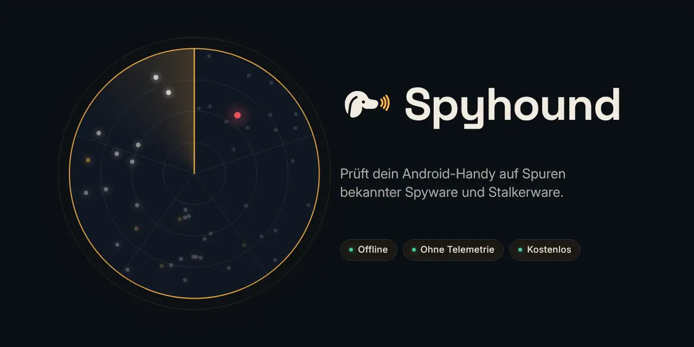
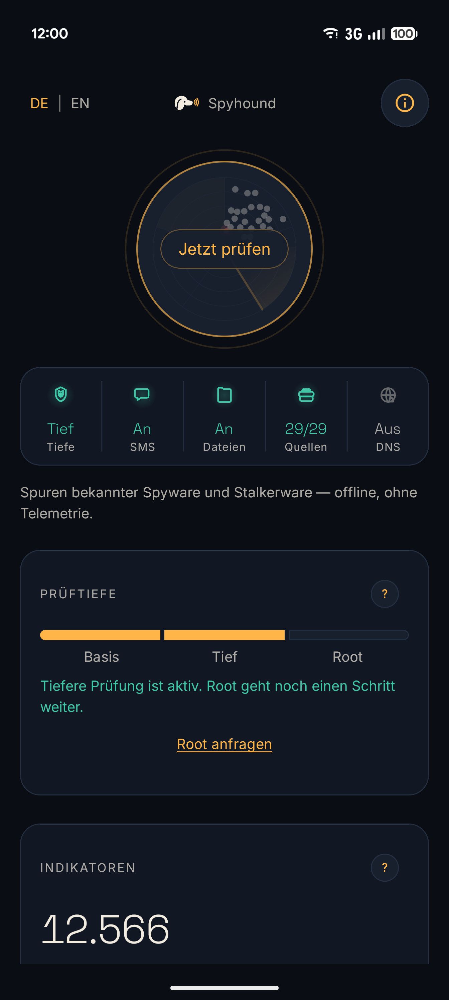
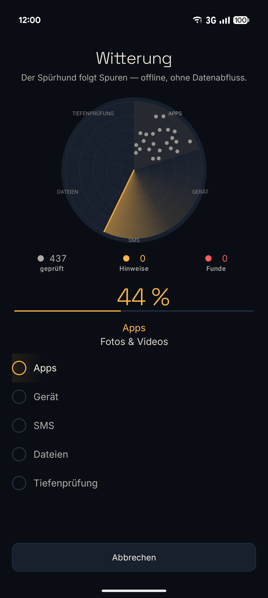
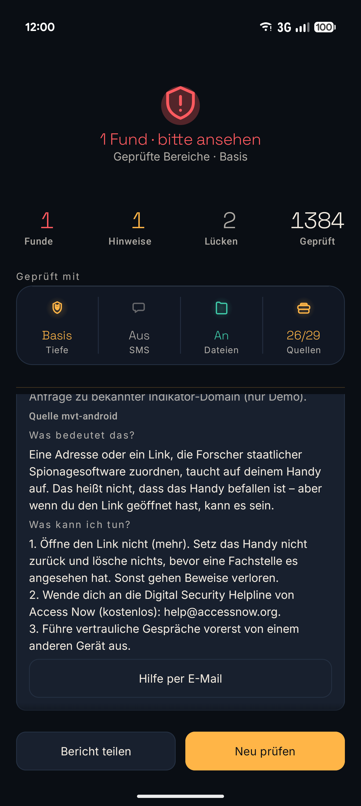
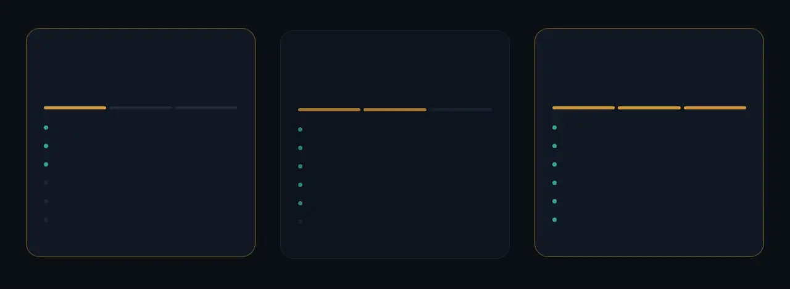

<p align="center">
  
</p>

<p align="center">
  <b>Prüft dein Android-Handy auf Spuren bekannter Spyware und Stalkerware.</b><br>
  Direkt auf dem Handy. Offline. Ohne Konto, ohne Tracking, kostenlos für alle.
</p>

<p align="center">
  <a href="https://github.com/BEKO2210/spyhound/releases/latest"></a>
  
  <a href="LICENSE"></a>
  
</p>

<p align="center">
  <a href="README.md">English version</a> ·
  <a href="#installieren">Installieren</a> ·
  <a href="#apk-prüfen">APK prüfen</a> ·
  <a href="#hilfe-bekommen">Hilfe bekommen</a>
</p>

<p align="center">
  
  &nbsp;
  
  &nbsp;
  
</p>

---

## Warum Spyhound

Wer ein Handy auf Spyware wie **Pegasus, Predator oder Graphite** prüfen will, braucht meist einen Computer, die
Kommandozeile und Werkzeuge für Fachleute. Menschen, die befürchten, überwacht zu werden – vom Staat, vom Ex-Partner
oder vom Arbeitgeber –, haben das selten. Spyhound bringt dieselben veröffentlichten Indikatoren aufs Handy, in
einfacher Sprache, auf Deutsch und Englisch.

- **Ein Tipp.** *Jetzt prüfen* – das Radar zeigt Schritt für Schritt, was gerade geprüft wird.
- **Ehrliche Ergebnisse.** Nie „dein Handy ist sauber“, sondern *keine bekannten Spuren in den geprüften Bereichen* –
  und jeder Bereich, der nicht geprüft werden konnte, wird genannt.
- **Was jetzt?** Jeder Fund und jeder Hinweis erklärt *Was bedeutet das?* und *Was kann ich tun?* – mit direkten
  Knöpfen (App-Info öffnen, richtige Einstellung öffnen, Beratungsstelle kontaktieren).
- **Nichts verlässt dein Handy.** Die Prüfung läuft offline. Keine Telemetrie, keine Werbung, kein Konto.

## Was geprüft wird

Spyhound vergleicht, was es auf deinem Handy sehen kann, mit **veröffentlichten Indikatoren** von
Sicherheitsforschern – App-Namen, APK-Fingerabdrücke, Signaturzertifikate, Domains, IP-Adressen und Dateinamen – aus
34 fest gepinnten Quellen (Amnesty Tech / MVT, Citizen Lab, ECHAP-Stalkerware-Liste, ESET-Schadsoftware-Hashes und
weitere). Installierte APKs und Dateien im Speicher werden zusätzlich gegen **ESET Research**-Listen
(`eset/malware-ioc`, BSD-2-Clause) geprüft: fünf Android-Kampagnen, **nur exakte SHA-256-Treffer** – kein
allgemeiner Virenscan. Außerdem weist es
auf Prüfenswertes hin, etwa Apps von außerhalb eines Stores mit weitreichenden Rechten, einen entsperrten Bootloader
oder einen alten Sicherheitspatch.

<p align="center"></p>

<details><summary>Als Tabelle</summary>

| Ergebnis | Bedeutung |
|---|---|
| 🔴 **Fund** | Ein veröffentlichter Indikator passt. Staatliche Spyware und Stalkerware bekommen unterschiedliche, vorsichtige Ratschläge. |
| 🟡 **Hinweis** | Prüfenswert, nie ein Alarm für sich – viele harmlose Apps sehen so aus. |
| ⚪ **Lücke** | Eine Prüfung, die nicht laufen konnte – und was sie möglich macht. |

</details>

### Prüftiefe

Jede Stufe ergänzt die vorige. Auch ohne Sonderrechte macht Spyhound alles, was Android erlaubt.

<p align="center"></p>

<details><summary>Als Tabelle</summary>

| Stufe | Was du brauchst | Was geprüft wird |
|---|---|---|
| **Basis** | Nichts | Installierte Apps (Namen, APK-Fingerabdrücke, Zertifikate, manuell installierte Apps mit heiklen Rechten), Gerätezustand (Patch-Stand, Bootloader, Root-Spuren, Debugging), Links in SMS (wenn erlaubt), Dateien im Speicher (wenn erlaubt) |
| **Tief** | WLAN-Debugging (Android 11+), einmal in der App eingerichtet – oder [Shizuku](https://shizuku.rikka.app/) | Alles aus Basis, dazu laufende Prozesse, die vollständige Paketliste, Systemprotokolle und `dumpsys` |
| **Root** | Ein gerootetes Handy | Alles aus Tief, mit Root-Zugriff |

</details>

Die Statusleiste auf dem Startbildschirm zeigt immer, welche Stufe aktiv ist und was Spyhound nutzen darf (SMS,
Dateien, Quellen, DNS-Wächter).

### Außerdem dabei

- **Offline-Schadsoftware-Fingerabdrücke** – Apps und Dateien in Downloads gegen mitgelieferte ESET-Hashlisten
  (AridSpy, VajraSpy, SpyLoan, NGate, PromptSpy). Nur exakte Treffer; wenige benannte Kampagnen – kein Ersatz für
  Play Protect und kein Echtzeitschutz.
- **Wer darf was** – jede App mit Zugriff auf Kamera, Mikrofon, Standort, SMS, Bedienungshilfe und mehr, nach Recht
  sortiert; seit der letzten Prüfung neu hinzugekommene Rechte sind markiert.
- **Handy absichern** – eine kurze Checkliste (Bildschirmsperre, Debugging, Sicherheitspatch, Apps, die Apps
  installieren dürfen) mit Knopf direkt zur richtigen Einstellung.
- **Geprüfter Zeitraum** – das Ergebnis sagt, wie weit Nachrichten, Systemprotokolle und Dateien zurückreichen, damit
  du weißt, was eine Prüfung sehen konnte und was nicht.
- **Wöchentliche Prüfung im Hintergrund** (freiwillig, standardmäßig aus) – nur Basis-Prüfungen, kein Netzwerk, und
  eine Benachrichtigung nur bei einem neuen Fund.
- **DNS-Wächter** – ein optionaler, lokaler Filter (kein VPN-Server), der warnt, wenn eine App auf deinem Handy eine
  Domain kontaktiert, die von Spyware bekannt ist.
- **Fehlerbericht-Analyse** – liest einen Android-Fehlerbericht (ZIP) offline, für Prüfungen, die Systemdaten brauchen.
- **Bericht teilen** – ein Textbericht für eine Beratungsstelle. Du entscheidest, ob und mit wem.

## Was Spyhound nicht kann

- **Kein Echtzeitschutz.** Es prüft, wenn du es willst.
- **Nur veröffentlichte Spuren.** Neue oder unveröffentlichte Spyware wird nicht erkannt.
- **„Keine bekannten Spuren“ ist keine Garantie**, dass dein Handy sicher ist.
- **Es entfernt keine Spyware.** Eine App zu entfernen kann die überwachende Person warnen – siehe
  [Hilfe bekommen](#hilfe-bekommen).

## Installieren

Spyhound gibt es als APK auf GitHub, nicht im Play Store.

1. Öffne auf dem Handy die [neueste Version](https://github.com/BEKO2210/spyhound/releases/latest) und lade
   `spyhound-<version>.apk` herunter.
2. Öffne die Datei. Android fragt, ob Installationen aus dieser Quelle erlaubt sind – erlaube es für diese eine
   Installation.
3. Installieren, danach die Erlaubnis wieder ausschalten.

Optional vor der Installation: Am Computer `sha256sum -c SHA256SUMS` ausführen oder den SHA-256-Fingerabdruck des
Signaturzertifikats mit dem auf der Release-Seite vergleichen (vollständiger Wert unter
[APK prüfen](#apk-prüfen)). Eine neuere Version installiert sich über die bestehende – du musst nicht vorher
deinstallieren.

Ab Android 10. Die tiefe Prüfung ohne PC braucht Android 11 oder neuer.

## APK prüfen

Jede Version ist mit demselben Schlüssel signiert. Vor der Installation kannst du prüfen, ob die Datei echt ist:

**Signaturzertifikat (SHA-256)**
```
2A:E3:BD:1B:92:01:73:9C:33:01:97:C3:00:70:6B:ED:B8:00:51:47:01:06:42:02:67:52:F9:29:84:26:BD:4A
```

```
apksigner verify --print-certs spyhound-<version>.apk   # Zertifikat muss mit der Zeile oben übereinstimmen
sha256sum -c SHA256SUMS                                   # Datei muss zur veröffentlichten Prüfsumme passen
```

Android selbst verweigert ein Update mit anderem Schlüssel – einmal installiert, kann nur ein echtes Update die App
ersetzen.

**Selbst nachbauen.** Releases sind reproduzierbar: Wer den Release-Tag baut, erhält byte-gleichen Inhalt (jede
dex-Datei, Ressource und Bibliothek – nur die Signatur fehlt, weil der Schlüssel fehlt):

```
scripts/verify-reproducible.sh v<version> spyhound-<version>.apk   # meldet REPRODUCIBLE oder die abweichenden Dateien
```

## Datenschutz

- **Die Prüfung ist offline.** Sie nutzt nie das Netzwerk.
- **Keine Telemetrie**, keine Tracker, keine Analyse, keine Werbung.
- **Netzwerk nur für Indikator-Updates**, und nur wenn du *Quellen aktualisieren* tippst: feste Quellen, feste
  Commits, jede Datei muss zu ihrer SHA-256-Prüfsumme passen, keine Weiterleitungen. Diese Verbindung zu
  `raw.githubusercontent.com` (GitHub, USA) überträgt deine IP-Adresse.
- Ergebnisse bleiben auf deinem Gerät, bis du sie teilst.

Impressum, Datenschutzerklärung und Haftungsausschluss: [docs/LEGAL.md](docs/LEGAL.md) (auch in der App unter
*Über Spyhound*). Verantwortlicher: Belkis Aslani, Vogelsangstraße 32, 71691 Freiberg am Neckar,
belkis.aslani@gmail.com.

## Hilfe bekommen

Wenn du glaubst, gezielt überwacht zu werden, verlass dich nicht allein auf diese App. Diese Stellen helfen kostenlos:

- **Access Now Digital Security Helpline** – <https://www.accessnow.org/help/> – help@accessnow.org
- **Amnesty International Security Lab** – <https://securitylab.amnesty.org/>
- **Hilfetelefon „Gewalt gegen Frauen“** – 116 016 (kostenlos, rund um die Uhr, viele Sprachen)

Wenn du um deine Sicherheit fürchtest: Überlege, wie eine sichtbare Änderung – eine App entfernen, das Handy
zurücksetzen – der überwachenden Person auffallen könnte. Setz das Handy nicht zurück, bevor eine Fachstelle es
angesehen hat, sonst gehen Beweise verloren.

## Häufige Fragen

**Braucht Spyhound Root?** Nein. Basis läuft auf jedem Handy; die tiefe Prüfung braucht nur WLAN-Debugging.

**Warum fragt es nach SMS und Dateien?** Um Links in Nachrichten und Dateien im Speicher mit bekannten Indikatoren zu
vergleichen. Beides ist freiwillig; ohne wird der Bereich als Lücke angezeigt.

**Ich kann SMS nicht erlauben.** Android schützt SMS bei Apps, die nicht über den Play Store installiert wurden
(„Eingeschränkte Einstellungen“). Öffne Einstellungen → Apps → Spyhound, tippe oben rechts auf ⋮, wähle
„Eingeschränkte Einstellungen zulassen“ und tippe in Spyhound erneut auf „Erlauben“. Spyhound zeigt diese Schritte
selbst an und öffnet die App-Info für dich.

**Warum WLAN-Debugging?** Android verbirgt Prozesse und Systemprotokolle vor normalen Apps. Über WLAN-Debugging kann
Spyhound sie direkt auf dem Handy lesen – ohne Computer, ohne zweite App. Nach der Prüfung kannst du es ausschalten.

**Es hat einen Hinweis gefunden. Bin ich gehackt?** Nicht unbedingt. Ein Hinweis ist etwas Prüfenswertes. Öffne ihn,
um zu sehen, was er bedeutet und was du tun kannst.

## Selbst bauen

Voraussetzungen: JDK 21 und das Android SDK (`sdk.dir` in `local.properties`).

```
./gradlew :app:testDebugUnitTest :app:assembleDebug
```

Die Debug-APK liegt danach in `app/build/outputs/apk/debug/`. Dokumentation: [Spezifikation](docs/SPEC.md),
[Roadmap](docs/ROADMAP.md), [Design-Maßstab](docs/DESIGN.md), [Testmatrix](docs/TESTMATRIX.md).

## Lizenz und Herkunft

Apache License 2.0, siehe [LICENSE](LICENSE). Spyhound setzt die Logik des
[Zero Breach Toolkit](https://github.com/interplains/Zero-Breach-Toolkit) in Kotlin neu um. Indikatorquellen und
Bibliotheken sind in [NOTICE](NOTICE) genannt.

## Unterstützen

Spyhound ist kostenlos und bleibt es – jede Prüfung, für alle, ohne Konto, Werbung oder Bezahlschranke. Wenn es dir
geholfen hat, kannst du die Entwicklung unterstützen: **[Auf GitHub sponsern](https://github.com/sponsors/BEKO2210)**.
