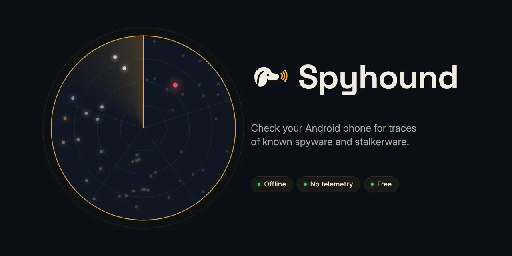
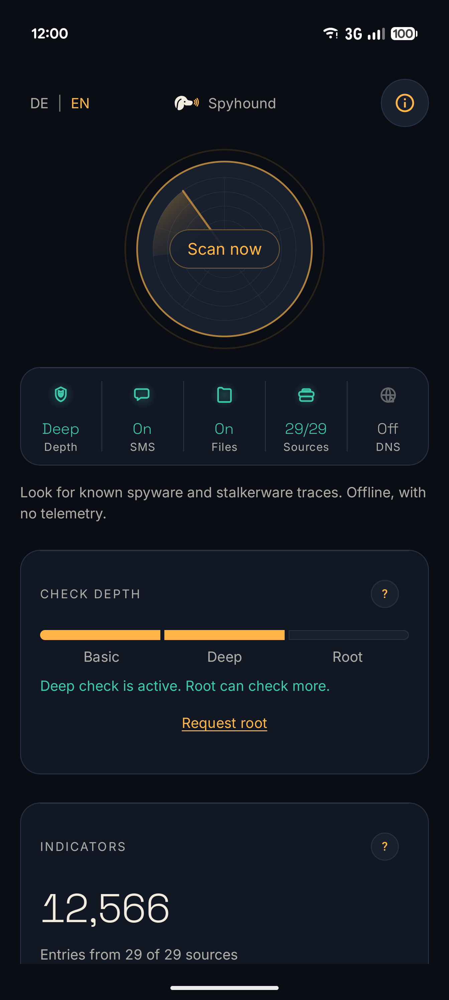
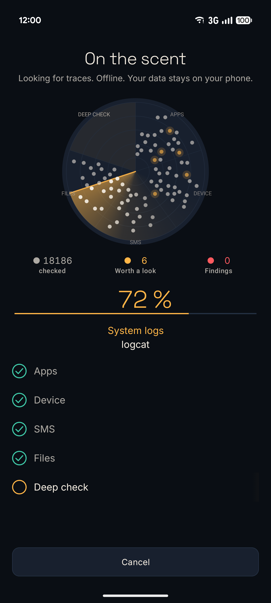
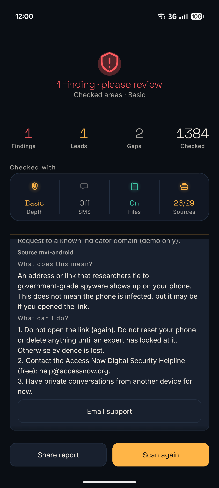

<p align="center">
  
</p>

<p align="center">
  <b>Check your Android phone for traces of known spyware and stalkerware.</b><br>
  On the phone itself. Offline. No account, no tracking, free for everyone.
</p>

<p align="center">
  <a href="https://github.com/BEKO2210/spyhound/releases/latest"></a>
  
  <a href="LICENSE"></a>
  
</p>

<p align="center">
  <a href="README.de.md">Deutsche Version</a> ·
  <a href="#install">Install</a> ·
  <a href="#verify-the-apk">Verify the APK</a> ·
  <a href="#getting-help">Getting help</a>
</p>

<p align="center">
  
  &nbsp;
  
  &nbsp;
  
</p>

---

## Why Spyhound

Checking a phone for spyware such as **Pegasus, Predator or Graphite** usually needs a computer, a command line and
expert tools. People who fear they are being watched – by a state, an ex-partner or an employer – rarely have any of
that. Spyhound brings the same published indicators to the phone, in plain language, in English and German.

- **One tap.** Press *Scan now*; the radar shows what is being checked, item by item.
- **Honest results.** Never "your phone is clean" – only *no known traces in the checked areas*, and every area that
  could not be checked is listed.
- **What to do next.** Every finding and every lead explains *What does this mean?* and *What can I do?*, with direct
  buttons (open app info, open the right setting, contact a helpline).
- **Nothing leaves your phone.** The scan runs offline. No telemetry, no ads, no account.

## What it checks

Spyhound compares what it can see on your phone with **published indicators of compromise** from security researchers
– app package names, APK hashes, signing certificates, domains, IP addresses and file names – from 29 pinned sources
(Amnesty Tech / MVT, Citizen Lab, ECHAP stalkerware list and more). It also points out things worth a closer look,
such as apps from outside a store with far-reaching permissions, an unlocked bootloader or an old security patch.

| Result | Meaning |
|---|---|
| 🔴 **Finding** | A published indicator matches. State-grade spyware and stalkerware get different, careful advice. |
| 🟡 **Lead** | Worth a look, never an alarm on its own – many harmless apps look like this. |
| ⚪ **Gap** | A check that could not run, with what would close it. |

### Check depth

Each level adds to the one before. Without special access Spyhound still does everything Android allows.

| Level | What you need | What is checked |
|---|---|---|
| **Basic** | Nothing | Installed apps (names, APK hashes, certificates, sideloaded apps with sensitive permissions), device state (patch level, bootloader, root traces, debugging), links in SMS (if allowed), files in shared storage (if allowed) |
| **Deep** | Wireless debugging (Android 11+), set up once in the app – or [Shizuku](https://shizuku.rikka.app/) | Everything in Basic, plus running processes, the full package list, system logs and `dumpsys` output |
| **Root** | A rooted phone | Everything in Deep, with root access |

The status panel on the start screen always shows which level is active and what Spyhound may use (SMS, files,
sources, DNS watch).

### Also included

- **DNS watch** – an optional local filter (no VPN server) that warns when an app on your phone contacts a domain
  known from spyware.
- **Bug report analysis** – read an Android bug report ZIP offline, for checks that need system data you cannot grant
  otherwise.
- **Share report** – a plain-text report you can hand to a helpline. You decide whether and with whom.

## What Spyhound does not do

- **No real-time protection.** It checks when you ask it to.
- **Only published traces.** New or unpublished spyware will not be detected.
- **"No known traces" is not a guarantee** that your phone is safe.
- **It does not remove spyware.** Removing an app can alert the person watching you – see [Getting help](#getting-help).

## Install

Spyhound is distributed as an APK on GitHub, not in the Play Store.

1. On your phone, open the [latest release](https://github.com/BEKO2210/spyhound/releases/latest) and download
   `spyhound-<version>.apk`.
2. Open the file. Android asks whether to allow installs from this source – allow it for this one install.
3. Install, then switch that permission off again.

Requires Android 10 or newer. The deep check without a PC needs Android 11 or newer.

## Verify the APK

Every release is signed with the same key. Before installing, you can check that the file is genuine:

**Signing certificate (SHA-256)**
```
2A:E3:BD:1B:92:01:73:9C:33:01:97:C3:00:70:6B:ED:B8:00:51:47:01:06:42:02:67:52:F9:29:84:26:BD:4A
```

```
apksigner verify --print-certs spyhound-<version>.apk   # certificate digest must match the line above
sha256sum -c SHA256SUMS                                   # file must match the published checksum
```

Android itself refuses an update that is signed with a different key, so once installed, only genuine updates can
replace it.

## Privacy

- **The scan is offline.** It never uses the network.
- **No telemetry**, no trackers, no analytics, no ads.
- **Network only for indicator updates**, and only when you tap *Update sources*: fixed sources, fixed commits, every
  file must match its SHA-256 checksum, no redirects. This connection to `raw.githubusercontent.com` (GitHub, USA)
  transmits your IP address.
- Results stay on your device until you share them.

Legal notice, privacy policy and disclaimer: [docs/LEGAL.md](docs/LEGAL.md) (German version authoritative; also in the
app under *About Spyhound*). Controller: Belkis Aslani, Vogelsangstraße 32, 71691 Freiberg am Neckar, Germany,
belkis.aslani@gmail.com.

## Getting help

If you think you are being targeted, do not rely on this app alone. These organisations help for free:

- **Access Now Digital Security Helpline** – <https://www.accessnow.org/help/> – help@accessnow.org
- **Amnesty International Security Lab** – <https://securitylab.amnesty.org/>
- **Germany, violence against women helpline** – 116 016 (free, 24/7, many languages)

If you fear for your safety, think about how a visible change – removing an app, resetting the phone – might be
noticed by the person monitoring you. Do not reset the phone before an expert has looked at it, or evidence is lost.

## FAQ

**Does Spyhound need root?** No. Basic works on every phone; the deep check needs only wireless debugging.

**Why does it ask for SMS and file access?** To check links in messages and files in shared storage against known
indicators. Both are optional; without them those areas are listed as gaps.

**Why does it want wireless debugging?** Android hides processes and system logs from normal apps. Wireless debugging
lets Spyhound read them on the phone itself – no computer, no second app. You can switch it off after the scan.

**It found a lead. Am I hacked?** Not necessarily. A lead is something worth checking. Open it to see what it means
and what you can do.

## Building from source

Requirements: JDK 21 and the Android SDK (`sdk.dir` in `local.properties`).

```
./gradlew :app:testDebugUnitTest :app:assembleDebug
```

The debug APK is written to `app/build/outputs/apk/debug/`. Documentation (German): [specification](docs/SPEC.md),
[roadmap](docs/ROADMAP.md), [design standard](docs/DESIGN.md), [test matrix](docs/TESTMATRIX.md).

## License and credits

Apache License 2.0, see [LICENSE](LICENSE). Spyhound reimplements the logic of the
[Zero Breach Toolkit](https://github.com/interplains/Zero-Breach-Toolkit) in Kotlin. Indicator sources and libraries
are credited in [NOTICE](NOTICE).

## Support

Spyhound is free and stays free – every scan, for everyone, without accounts, ads or a paywall. If it helped you, you
can support its development: **[Become a sponsor on GitHub](https://github.com/sponsors/BEKO2210)**.
